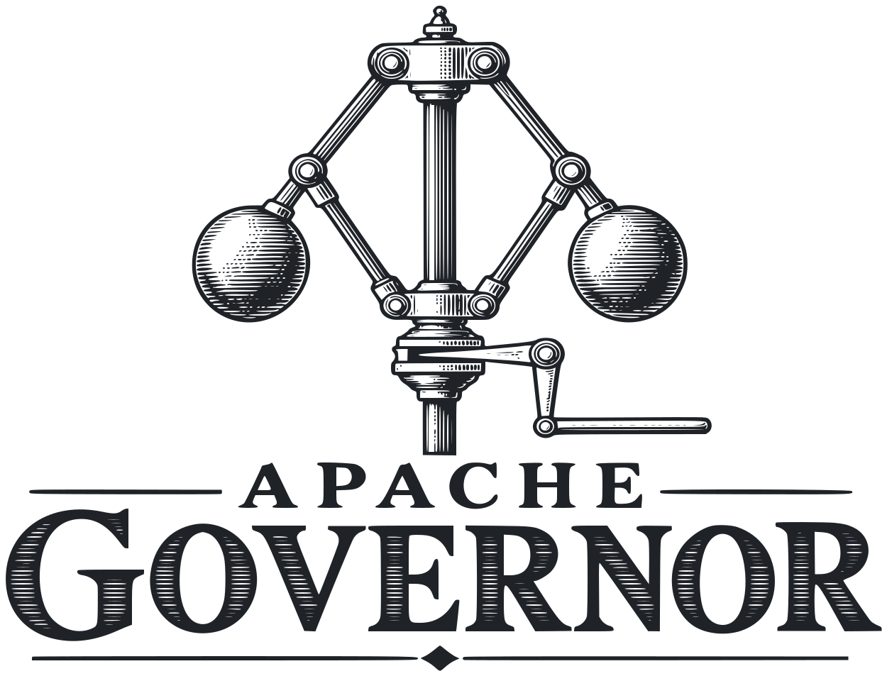

<p align="center">
  <picture>
    <source media="(prefers-color-scheme: dark)" srcset="website/static/img/governor-wordmark-dark.svg">
    
  </picture>
</p>

# Governor

[](LICENSE)
[](https://github.com/apache/rai-governor/issues)

Governor is a provider- and model-agnostic toolkit and web application for prototyping AI agents and the lightweight web UIs that wrap them. Subject matter experts compose tools, data sources, and decision paths through a guided interface, preview agent interactions in real time, and hand off working agent-driven experiences without committing to a single AI framework or model provider.

## What you can do

- **Prototype agents quickly.** Compose tools, data sources, and decision paths through a guided interface, and iterate with real-time feedback.
- **Design lightweight web UIs.** Pair agents with forms, chat surfaces, and dashboards to validate user journeys; export or embed prototypes to share with stakeholders.
- **Stay flexible.** Governor supports multiple model providers (OpenAI, Anthropic, Gemini, and others via LiteLLM) and is designed to keep your work portable across them.

## Quickstart

```bash
git clone https://github.com/apache/rai-governor.git
cd rai-governor/webapp/infra/docker
docker-compose up --build
```

See the [quickstart guide](docs/quickstart/README.md) for details, including required environment configuration.

## Documentation

Full documentation lives in [`docs/`](docs/) and is published at <https://apache.github.io/rai-governor/>. Highlights:

- [Quickstart](docs/quickstart/README.md)
- [Developer quickstart](docs/developers-quickstart.md)
- [API reference](docs/api.md)
- [LLM provider configuration](docs/llm-provider-configuration.md)
- [Testing](docs/testing/README.md)

## About the name

Governor began as a fork of Gofannon, the Welsh god of tooling. His Irish relative Goibniu (pronounced Gov-nyoo) led to the similar-sounding Apache Governor: in machinery, a governor automatically controls a machine's operation to keep it safe. See [About the name](docs/about-name-origin.md) for more.

## Roadmap

Planned features and their current status are tracked in the [roadmap](docs/roadmap.md).

## Community

- Report bugs or request features in [GitHub Issues](https://github.com/apache/rai-governor/issues).

## Contributing

Contributions are welcome. See [CONTRIBUTING.md](CONTRIBUTING.md) for how to get started, including the "good first issue" label for newcomers and contribution guides for adding tools, integrating new agentic frameworks, and extending the web UI.

## Acknowledgments

Governor is a fork of [Gofannon](https://github.com/apache/tooling-gofannon), originally created by The AI Alliance. Thanks to its authors and to the open-source community for contributions and support that have made this project possible.

[](https://github.com/apache/rai-governor/graphs/contributors)

## License

Governor is licensed under the Apache License, Version 2.0. See [LICENSE](LICENSE) for the full text.
